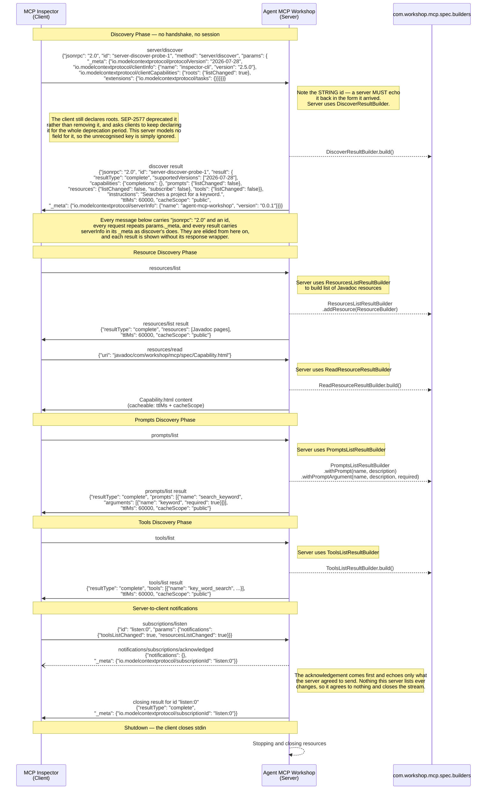

# MCP Json Communication Flow Diagram

The JSON below is what the server sends by the end of chapter 04. The builders it names, in `com.workshop.mcp.spec.builders`, arrive in chapters 03 and 04, so they are not on this branch yet. Chapters 05 to 07 add a round trip, an MCP App UI, and task handles.

