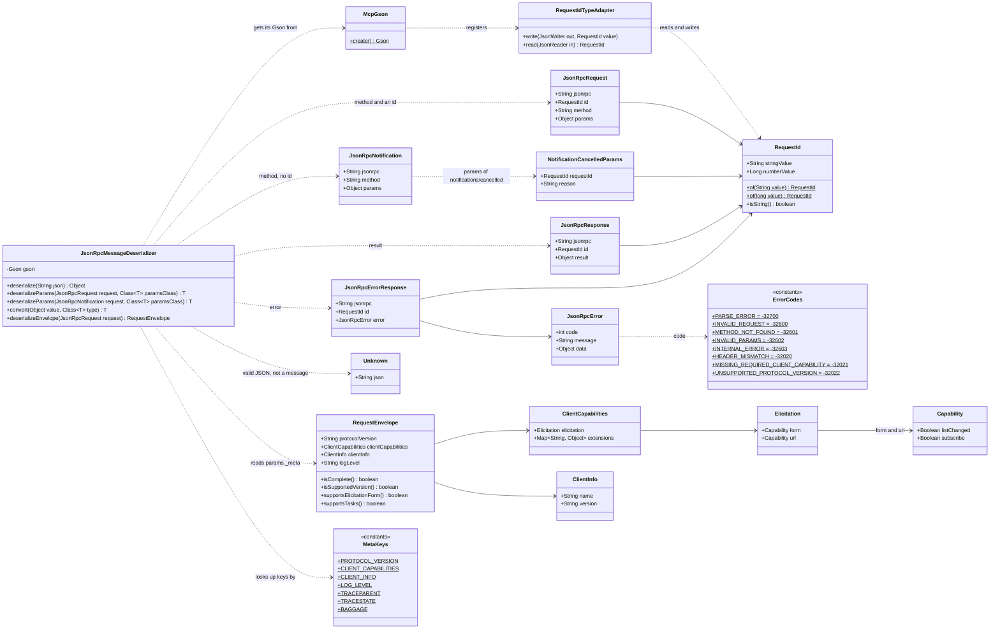

# Chapter 02 Class Diagram: Reading JSON-RPC Messages

These are the classes on the chapter 02 branch, all in `com.workshop.mcp.spec`. `JsonRpcMessageDeserializer` is the one you implement; everything else is given. The result types, params records and builders arrive with the chapters that use them, starting with `DiscoverResult` in chapter 03.

## Reading the diagram

- **Five possible answers from `deserialize`.** The four JSON-RPC shapes, plus `Unknown` for well-formed JSON that is not a JSON-RPC 2.0 message: an array, a bare value, an object without `"jsonrpc": "2.0"`, an object with none of `method`, `result` and `error`, or one whose members have the wrong types, such as an id that is an object. Text that is not JSON at all throws instead, so chapter 03 can answer the two cases with different errors.
- **An id is a string or a number, never both.** `RequestId` keeps whichever form arrived, and `RequestIdTypeAdapter` writes it back the same way, because a server must quote an id exactly as the client sent it. `McpGson.create()` is the one place the adapter is registered, so every component that reads or writes JSON shares it.
- **The envelope is not a params record.** Its keys, such as `io.modelcontextprotocol/protocolVersion`, are not legal Java identifiers, so `deserializeEnvelope` reads them by the names in `MetaKeys` and builds a `RequestEnvelope` by hand.
- **`traceparent`, `tracestate` and `baggage`** are in `MetaKeys` because the specification reserves them unprefixed for W3C trace context. This server does not read them yet; see the stretch exercise in the [instructions](02-instructions.md).
- **`ErrorCodes` is defined here and used from chapter 03 on.** The -32000 to -32019 block is legacy, so the server uses only the JSON-RPC codes and the specification's own reserved ones.
