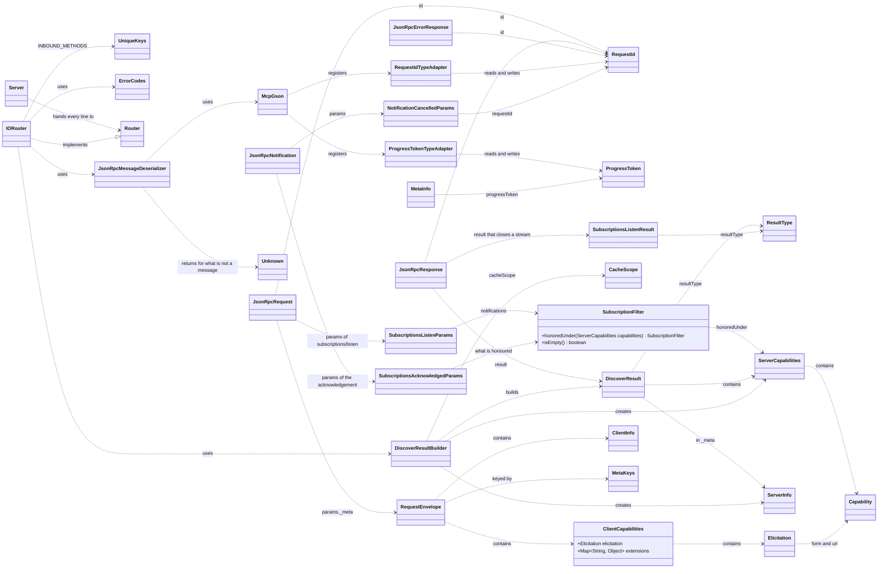

# Server Class Diagram

These are the classes on the chapter 03 branch that the router works with. `IORouter` holds the five pieces you write; everything else is given, and the JSON-RPC types, `RequestId` and `McpGson` come from chapter 02.

