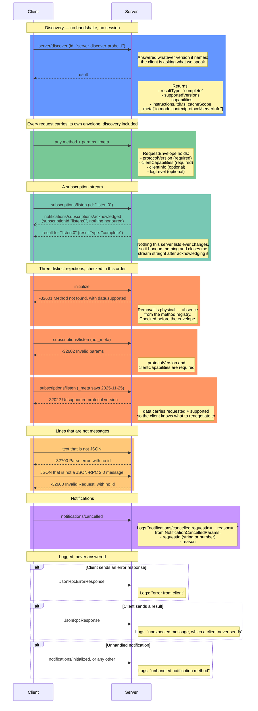

# Server Sequence Diagram

What a chapter 03 server does with each kind of line. Methods other than `server/discover` and `subscriptions/listen` are `-32601` until chapter 04, which is why the envelope rejections below are shown on a listen request.

