# MCP Message Flow - Lesson 4: Resources, Tools, and Prompts

This diagram shows the message flows for the three main capabilities implemented in lesson 4, and for completion.

```mermaid
sequenceDiagram
    participant Client
    participant Server
    
    Note over Client,Server: Prerequisites: server/discover answered, and every request below carries its own params._meta envelope (from Lesson 3)
    
    rect rgb(100, 200, 100)
        Note over Client,Server: Resource Operations
        Client->>Server: resources/list (request)
        Note right of Server: Loads all Javadoc HTML files<br/>from classpath
        Server-->>Client: resources/list (response)
        Note right of Client: Receives the documentation resources<br/>with ttlMs and cacheScope, and no nextCursor
        
        Client->>Server: resources/templates/list (request)
        Server-->>Client: resources/templates/list (response)
        Note right of Client: An empty resourceTemplates list
        
        Client->>Server: resources/read (request)
        Note right of Client: Sends resource URI<br/>(e.g., "javadoc/com/.../Resource.html")
        Note right of Server: Reads HTML content<br/>from classpath
        Server-->>Client: resources/read (response)
        Note right of Client: Receives HTML content<br/>with MIME type "text/html"
    end
    
    rect rgb(100, 150, 255)
        Note over Client,Server: Tool Operations
        Client->>Server: tools/list (request)
        Note right of Server: Creates KeyWordSearch instance<br/>Returns tool metadata
        Server-->>Client: tools/list (response)
        Note right of Client: Gets tool info:<br/>- name: "key_word_search"<br/>- description<br/>- JSON schema
        
        Client->>Server: tools/call (request)
        Note right of Client: Sends tool name and arguments:<br/>- keyword: "class"<br/>- directory: "/path/to/project"
        Note right of Server: Executes KeyWordSearch<br/>Searches files for keyword
        Server-->>Client: tools/call (response)
        Note right of Client: Receives search results:<br/>- file paths<br/>- occurrence counts
    end
    
    rect rgb(255, 150, 100)
        Note over Client,Server: Prompt Operations
        Client->>Server: prompts/list (request)
        Note right of Server: Returns "search_keyword" prompt<br/>with required arguments
        Server-->>Client: prompts/list (response)
        Note right of Client: Gets prompt definition:<br/>- name: "search_keyword"<br/>- argument: "keyword" (required)
        
        Client->>Server: completion/complete (request)
        Note right of Client: Sends the argument name "keyword"<br/>and what the user has typed so far
        Server-->>Client: completion/complete (response)
        Note right of Client: completion: values java, the, and<br/>with total 3 and hasMore false
        
        Client->>Server: prompts/get (request)
        Note right of Client: Sends prompt name<br/>and its keyword argument
        Note right of Server: Builds one message<br/>around the keyword
        Server-->>Client: prompts/get (response)
        Note right of Client: Receives one user message asking<br/>the model to run key_word_search
    end
    
    Note over Client,Server: Errors and Results
    
    Client->>Server: tools/call (request)
    Note right of Client: Unknown tool name
    Server-->>Client: error -32602
    Note right of Server: "Unknown tool: ..."<br/>The request named something that is not there
    
    Client->>Server: tools/call (request)
    Note right of Client: key_word_search with no directory
    Server-->>Client: tools/call (response) with isError true
    Note right of Server: Still a result: the tool ran,<br/>and its text tells the model what to fix
    
    Client->>Server: resources/read (request)
    Note right of Client: Empty or unknown URI
    Server-->>Client: error -32602
    Note right of Server: Unknown: "Resource not found",<br/>with the uri in data.<br/>Empty: "resources/read requires a uri"
    
    Client->>Server: prompts/get (request)
    Note right of Client: Unknown prompt, or no keyword
    Server-->>Client: error -32602
```

## Key Message Flows in Lesson 4

### Resources Flow
1. **List Resources**: Client discovers available Javadoc HTML documentation
2. **List Templates**: Answered with an empty list, because the server has no templates
3. **Read Resource**: Client retrieves specific HTML content by URI

### Tools Flow
1. **List Tools**: Client discovers the KeyWordSearch tool and its schema
2. **Call Tool**: Client executes keyword search with parameters

### Prompts Flow
1. **List Prompts**: Client discovers the search_keyword prompt template
2. **Complete**: Client asks for values for the `keyword` argument while the user types it
3. **Get Prompt**: Client receives the message to hand the model

### Errors and Results
- A request naming a tool, prompt or resource the server does not have, or missing a required prompt argument, gets a `-32602` error. A missing resource names its uri in `data`
- A tool that ran and failed, such as a search with no directory, returns a result with `isError: true`. It is still a result, and its text is written for the model to act on
