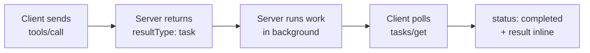
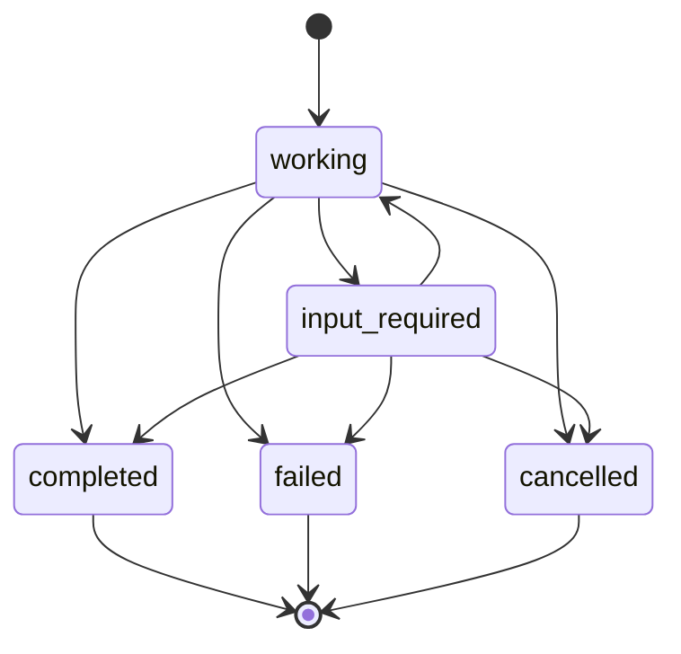

# Overview: Tasks — Call Now, Fetch Later

## Core Objective

Make the workshop server speak the **`io.modelcontextprotocol/tasks` extension**, which turns a long-running call into one the client polls. Instead of holding a request open for minutes, your server hands back a **task handle** at once, runs the work in the background, and lets the client poll or cancel on its own schedule.

> **Spec reference:** tasks began as [SEP-1686](https://github.com/modelcontextprotocol/modelcontextprotocol/issues/1686), an **experimental** feature of the `2025-11-25` specification. [SEP-2663](https://github.com/modelcontextprotocol/ext-tasks/blob/main/seps/2663-tasks-extension.md) moved them **out of the core protocol** into an official extension and reshaped them on the way. The extension's `2026-07-28` version is **Stable**: [https://modelcontextprotocol.io/extensions/tasks/overview](https://modelcontextprotocol.io/extensions/tasks/overview)

## What Changed on 2026-07-28

Tasks were reshaped more than any other part of the protocol, so it is worth having the whole list up front:

| Before | Now |
|--------|-----|
| top-level `tasks` capability slot | `extensions["io.modelcontextprotocol/tasks"]` |
| client opts in with `params.task` | **server decides**; servers MUST ignore an inbound `task` field |
| `tasks/result` (blocking) | **removed**: poll `tasks/get` instead |
| `tasks/list` | **removed** |
| — | `tasks/update` (**new**) |
| `tasks/cancel` answered with the task | answered with an empty acknowledgement |
| `ttl` / `pollInterval` | `ttlMs` / `pollIntervalMs`, and the TTL is the server's alone |
| `notifications/tasks/status` | `notifications/tasks`, sent only to a client that subscribed |
| `_meta["…/related-task"]` wrapper | flat `taskId` |
| `tool.execution.taskSupport` | **removed** |
| client-hosted tasks for `elicitation/create` and `sampling/createMessage` | **removed**: only servers create tasks |

SEP-2663 gives four reasons for these changes:

- **The handshake was fragile.** A client could ask for a task only once `tools/list` had told it which tools accepted one, and the `tasks.requests.*` capabilities said which methods did. Now the server decides, and declaring the extension is the only handshake.
- **`tasks/result` blocked.** A client that saw `input_required` had to call it, so that the server had a stream to send its question on, and the call then blocked until the whole operation finished. A server may no longer send a request the client did not ask for, so the question now travels in the task's status, and `tasks/update` carries the answer back.
- **`tasks/list` could not be scoped.** With no sessions, a server cannot tell which tasks belong to which caller. A task id is an unguessable handle the server recognizes one at a time, and a listing would leak them.
- **Client-hosted tasks could not be expressed.** A client used to be able to run an elicitation or a sampling request as a task, which the server then polled. Every such poll would be a request the client never asked for, so only servers create tasks now.

## What Are Tasks?

A task is a **state machine** kept by the server, the side doing the work. It holds the current status and, once there is one, the result, and it is addressed by a `taskId` the server generates.



The mental model: **request acceptance** and **request completion** are two separate round trips. The first is fast, just long enough to start the work. The second happens whenever the client cares to check.

The final poll returns the result *inline*. There is no second call to fetch it, because `tasks/result` is gone.

## Why It Matters

| Concern | Without Tasks | With Tasks |
|---|---|---|
| Long-running tool call | The request stays open until the work ends | The server answers in milliseconds, and the client polls |
| Dropped connection | The result is lost with it | A server that outlives the connection still answers for the task id until its TTL runs out |
| Concurrent dispatch | One slow tool blocks the LLM | The LLM keeps working while the task runs |
| Batch workflows | Awkward: every call blocks | Native: dispatch many, collect later |
| Stateless transport | Requires a server-push channel | Plain request and response |

A dropped connection only helps a server that keeps running. This one runs over stdio as the client's child process and keeps its tasks in memory, so its tasks end with the client.

## The Lifecycle State Machine



Three terminal states, `completed`, `failed` and `cancelled`, and once there a task never moves again. Once a task's TTL has run out, counted from its `createdAt`, the server may mark it `failed` and delete it after that. This server does neither, and keeps every task until it stops.

## Capability Negotiation

There is no `tasks` capability object to fill in any more. Both sides declare the extension by identifier, and an empty `{}` means "supported, no settings".

Server, in its `server/discover` result:

```json
{
  "capabilities": {
    "extensions": {
      "io.modelcontextprotocol/tasks": {}
    }
  }
}
```

Client, in **every request's** `_meta` envelope:

```json
"_meta": {
  "io.modelcontextprotocol/clientCapabilities": {
    "extensions": { "io.modelcontextprotocol/tasks": {} }
  }
}
```

That difference in *where* the two live is the important part. The server declares once, at discovery. The client declares again on every request, so the question "may this client be handed a task?" is about **the request being answered**, never about a connection. A client that declares only the old top-level `tasks` capability counts as not declaring the extension.

## Task Creation Is the Server's Decision

Tasks add nothing to the request any more. There is no `task` field to append, and a server MUST ignore one if an older client sends it.

The server decides per call, and only ever hands a handle to a client that declared the extension on that very request:

```java
private boolean answersWithTask(RequestEnvelope envelope) {
    return TASK_HANDLES_ENABLED && envelope.supportsTasks();
}
```

A task handed to a client that will not poll is a result nobody collects, which is why the second half of that condition is not optional.

## The Three Methods

| Method | Direction | Purpose |
|---|---|---|
| `tasks/get` | client → server | Non-blocking poll. Returns the task, plus `result` once it has completed, `error` once it has failed, or `inputRequests` while it waits for input. |
| `tasks/update` | client → server | **New.** Delivers `inputResponses` to a task in `input_required`. Acknowledged with an empty result; answers under keys the task is not waiting on are ignored. |
| `tasks/cancel` | client → server | Asks the server to cancel. Acknowledged with an empty result, even for a task that has finished, which keeps its status. The server need not stop the work. |
| `notifications/tasks` | server → client | Optional push of a task's state, sent only to a client that subscribed to that task with `subscriptions/listen`. Polling is the default, and this server sends none. |

`tasks/result` and `tasks/list` are **removed**, and removal in this revision is physical: sending either one gets `-32601`, not a polite refusal. Every task method also requires the extension: a client that did not declare it on the request gets `-32021`. So does a `subscriptions/listen` from that client that asks for task status by naming `taskIds`.

## A Handle or a Question — Never Both

This is the subtlest point in the chapter, and the one most likely to bite.

`resultType` holds **one** value. So the response to a `tools/call` is *either* a task handle *or* an `input_required`, never one and then the other. That forces an ordering on your handler: **commit to the answer shape before the tool works out what it is missing.**

Get it backwards and a task-declaring client receives an `input_required`, which the Inspector rejects outright:

> Unsupported result type 'input_required' for tools/call: multi-round-trip auto-fulfilment is not enabled on this instance

Nothing is lost by committing early, because a task has its own way to ask. The question moves off the call and onto the task, where it surfaces as an `input_required` **status** that a client sees when it polls:

```json
{"resultType":"complete","status":"input_required",
 "inputRequests":{"search_directory":{"method":"elicitation/create",
                                      "params":{"mode":"form","message":"…","requestedSchema":{ … }}}}}
```

and answers with `tasks/update`:

```json
{"method":"tasks/update",
 "params":{"taskId":"3dab39bc-…",
           "inputResponses":{"search_directory":{"action":"accept",
                                                 "content":{"directory":"/path/to/repo"}}}}}
```

Same MRTR vocabulary as Chapter 5: `inputRequests` and `inputResponses`, keyed by the server's own labels. The difference is the carrier. A synchronous call is retried under a new id and needs a `requestState` to carry its continuation, whereas a task already **has** an identity, so the `taskId` does the correlating and no `requestState` is needed.

## Error Codes Used

| Code | When |
|---|---|
| `-32601` Method not found | `tasks/result` or `tasks/list`, both removed. |
| `-32602` Invalid params | An unknown or missing `taskId`. |
| `-32021` Missing required client capability | A task method, or a `subscriptions/listen` naming `taskIds`, from a client that did not declare the extension on that request. |

A task that fails carries its own JSON-RPC error, a `-32603` Internal error here, inside the `tasks/get` result. That result is still `resultType: "complete"`: the poll succeeded; the work did not. Keeping those distinct is what lets a client tell a broken task from a broken protocol. A tool result with `isError: true` is not a failure at all: the task completes, with that result in it.

## What Students Will Achieve

By the end of this chapter you will have:

- ✅ Declared tasks as an **extension**, not a capability slot
- ✅ Read the reshaped records, `Task`, `TaskResult`, `TasksGetParams`, `TasksUpdateParams` and `TasksCancelParams`, with `ttlMs` and `pollIntervalMs`
- ✅ Built a framework-free `TaskStore` that carries a task through its whole lifecycle, `input_required` included
- ✅ Answered the three methods, with an empty acknowledgement for `tasks/update` and `tasks/cancel`
- ✅ Made task creation a **server** decision, gated on what the client declared on that request
- ✅ Committed to the answer shape before asking anything, so a handle and a question never collide
- ✅ Implemented the task-level round trip, where the question is a status and `tasks/update` is the answer
- ✅ Verified end to end in MCP Inspector: handle → poll → input_required → update → completed, plus cancel

## Stretch — Out of Scope for This Chapter

- Stopping the work when a task is cancelled
- Pushing `notifications/tasks` to a client that subscribes with `subscriptions/listen`
- Persisting tasks beyond process lifetime, and expiring them after their TTL
- Authorization-context binding (the workshop is stdio-only, with no auth)
- Multiple concurrent tasks per client and any fairness policy between them
