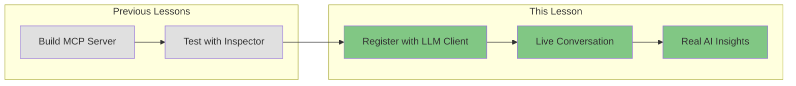
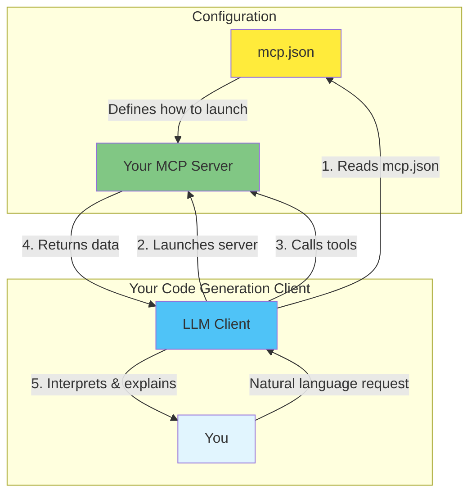
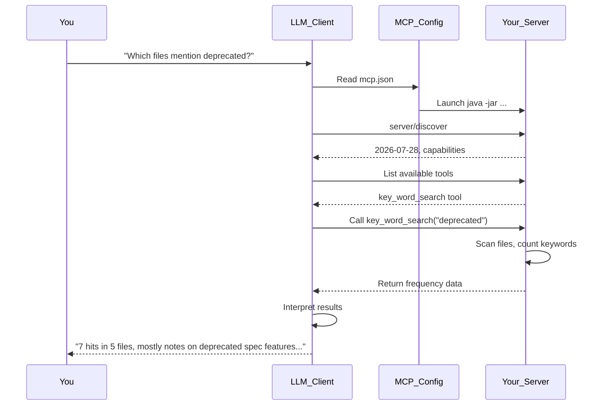

# Overview: Running Your MCP Server with a Live LLM

> **Bonus appendix — running against a live LLM.**
> This was chapter 6 before MCP Apps took that slot. It is not part of the
> timed workshop, but it is the natural thing to do once the server works:
> point a real assistant at it and watch a model choose your tool.
> It runs on the finished server, and needs a client that speaks revision
> `2026-07-28`.

## The Complete Lifecycle: From Code to Conversation

Congratulations! You've built and tested your `key_word_search` MCP server using the MCP Inspector. Now it's time for the exciting part: connecting your MCP server to a **live LLM** and watching it work in a real conversation.

In this lesson, you'll use your favorite code generation client (Claude Code, Cursor, Windsurf, Cline, or any MCP-compatible tool) to register your newly written MCP server and see it run with a live LLM—not the Inspector anymore. This demonstrates the complete lifecycle of MCP development.

## What You'll Experience



## The Journey So Far

1. **Built**: Created an MCP server with the `key_word_search` tool
2. **Tested**: Verified it works using the MCP Inspector
3. **Now**: Connect it to a real LLM and have an actual conversation

## The Architecture: Your Tool + AI Reasoning



## Why This Matters

With the MCP Inspector, you manually tested individual tool calls. Now you'll see:

- **Natural Language**: Ask questions in plain English
- **Tool Selection**: The LLM decides when to use your tool
- **Interpretation**: Raw data becomes meaningful insights
- **Conversation**: Follow-up questions and deeper analysis

## What Your MCP Server Provides

Your `key_word_search` tool handles the predictable, deterministic work. Asked for `deprecated` in `src/main/java`, it answers with one text item per matching file:

```text
/path/to/agent-mcp-workshop/src/main/java/com/workshop/mcp/IORouter.java, keyword_count=2
/path/to/agent-mcp-workshop/src/main/java/com/workshop/mcp/spec/AppMeta.java, keyword_count=2
/path/to/agent-mcp-workshop/src/main/java/com/workshop/mcp/spec/InputRequest.java, keyword_count=1
```

## What the LLM Adds

The AI interprets, explains, and provides context:

> "'deprecated' appears 7 times across 5 files. The two hits in `IORouter.java` are comments about features revision 2026-07-28 deprecates, and the two in `AppMeta.java` explain why it still emits the old flat `ui/resourceUri` key. Would you like me to walk through each one?"

## Division of Responsibilities

### Your MCP Server Tool Handles:
- File system traversal
- Pattern matching and counting
- Data aggregation
- Structured data output
- Consistent, repeatable operations

### The LLM Handles:
- Understanding your intent
- Choosing when to use tools
- Interpreting raw data
- Applying domain knowledge
- Generating contextual insights
- Explaining "why" patterns exist

## Supported Code Generation Clients

You can use any MCP-compatible client that speaks revision `2026-07-28`; this server refuses the `initialize` handshake that earlier revisions open with.

| Client | MCP Config Location |
|--------|---------------------|
| **Claude Code** (2.1.292 or later) | `./start_claude_mcp.sh` passes `lessons/mcp.json` with `--mcp-config`; Claude Code also reads a project `.mcp.json` |
| **Cursor** | Settings → MCP, once it speaks `2026-07-28`; the version checked speaks `2025-11-25` |
| **Windsurf** | `~/.codeium/windsurf/mcp_config.json` |
| **Cline** | VS Code extension settings |
| **Continue** | `~/.continue/config.json` |

## The Complete Lifecycle



## What You'll Do

1. **Configure**: Point your client at the server, using `lessons/mcp.json`
2. **Launch**: Start your code generation client
3. **Converse**: Ask questions that use your tool
4. **Observe**: Watch the complete lifecycle in action

## The Power of This Integration

This is what makes MCP powerful:

- **You built** a specialized tool that does one thing well
- **The LLM** knows when and how to use it
- **Together** they create an experience neither could provide alone

Your deterministic tool + AI reasoning = Actionable insights

## Next Steps

Follow the instructions to:
1. Read the server configuration in `lessons/mcp.json`
2. Register it with your chosen client
3. Have your first live conversation with your MCP server

You're about to see your code come to life in a real AI conversation!